<!-- ==================== CUSTOM ANIMATED NEON BANNER (avatar + name) ==================== -->
<div align="center">



<!-- animated typing -->
<a href="https://github.com/itsvaish8015">
  
</a>

<br/>

<!-- contact badges (no profile-views badge) -->
<a href="https://linkedin.com/in/vaishnav8015"></a>
<a href="mailto:vaishnav8015@gmail.com"></a>


</div>


<!-- ==================== ABOUT ==================== -->
<h2 align="center">⚡ About Me</h2>

```yaml
name:     Srivaishnav S
role:     Recent Computer Science Engineering Graduate
open_to:  Entry-level Data Analytics / IT Services roles
location: Chennai, Tamil Nadu, India
focus:    [ Data Analytics, Machine Learning, Data Visualization, Network Analysis ]
mindset:  "Learn → Build → Analyze → Improve"
```

A recent **Computer Science Engineering graduate** seeking an entry-level opportunity in **Data Analytics**, applying technical knowledge and problem-solving skills to practical challenges. Open to other **IT opportunities** that align with my technical background and interests.


<!-- ==================== TECH STACK ==================== -->
<h2 align="center">🛠️ Tech Stack</h2>

<div align="center">


<br/><br/>


</div>

<br/>

| Area | Skills |
| --- | --- |
| 💻 Programming | Java, Python |
| 🌐 Web | HTML, CSS, JavaScript |
| 🗄️ Database | SQL (MySQL) |
| 🤖 Machine Learning | Classification, Clustering, Data Cleaning |
| 📊 Data Visualization | Power BI, Matplotlib, Seaborn |
| 🕸️ Networking | Packet Analysis, Protocol Inspection (TCP/UDP/DNS/TLS) |
| 🧰 Tools | VS Code, Eclipse, Git & GitHub |
| 🖥️ OS | Windows, Linux |


<!-- ==================== PROJECTS ==================== -->
<h2 align="center">🚀 Featured Projects</h2>

<table>
  <tr>
    <td width="50%" valign="top">
      <h3>📊 Employee Compensation & Workforce Analysis</h3>
      <p><code>08/2026 – 09/2026</code></p>
      <ul>
        <li>Analyzed <b>107 employee records</b>: department/region distribution, salary vs. job-range, payroll by country, hiring trends.</li>
        <li>Cleaned data, derived 5 fields and ran <b>20 SQL queries</b> on MySQL.</li>
        <li>Built a <b>Power BI</b> dashboard: 3 KPI cards, 5 charts, 4 slicers.</li>
        <li><b>Finding:</b> Shipping + Sales = 74% of staff; US + UK = 95% of payroll.</li>
      </ul>
      <p>  </p>
      <a href="https://github.com/itsvaish8015/Employee-Compensation-and-Workforce-Analysis-"></a>
    </td>
    <td width="50%" valign="top">
      <h3>🛡️ Customer Insurance Purchase Prediction</h3>
      <p><code>Machine Learning Project</code></p>
      <ul>
        <li>Compared <b>5 classifiers</b> to predict insurance purchase behavior.</li>
        <li><b>Best model: KNN @ 93%</b> accuracy, 89% precision, 92% recall.</li>
        <li>Full pipeline: cleaning, encoding, scaling, training, evaluation.</li>
      </ul>
      <p>  </p>
      <a href="https://github.com/itsvaish8015/-Customer-Insurance-Purchase-Prediction-System"></a>
    </td>
  </tr>
  <tr>
    <td width="50%" valign="top">
      <h3>🛰️ Network Traffic Analysis & Anomaly Detection</h3>
      <p><code>09/2025 – 10/2025</code></p>
      <ul>
        <li>Live packet capture across <b>TCP, UDP, DNS & TLS</b> using <b>TShark + Java</b>.</li>
        <li>Rule-based anomaly detection (TCP &gt; 1000 B, UDP &lt; 50 B) — <b>10% anomaly rate</b>.</li>
        <li>Traffic summaries + web dashboard with bar charts and a network map.</li>
      </ul>
      <p>  </p>
      <a href="https://github.com/itsvaish8015/Network-Traffic-Analysis-Tool"></a>
    </td>
    <td width="50%" valign="top">
      <h3>✨ What's Next</h3>
      <p>Actively building new projects in <b>Data Analytics</b>, <b>Machine Learning</b> and <b>IT Services</b>.</p>
      <p><a href="https://github.com/itsvaish8015?tab=repositories">See all repositories →</a></p>
      <p><a href="https://linkedin.com/in/vaishnav8015">Let's connect on LinkedIn →</a></p>
    </td>
  </tr>
</table>


<!-- ==================== CERTIFICATIONS ==================== -->
<h2 align="center">📜 Certifications</h2>

- 🏅 **AI Fundamentals** — Coursera
- 📊 **Introduction to Power BI** — AI Planet
- 🐍 **Introduction to Python Basics for Data Science** — AI Planet
- 🗄️ **Introduction to Databases for Back-End Development** — Coursera


<!-- ==================== GITHUB STATS (NEON) ==================== -->
<h2 align="center">📈 GitHub Stats</h2>

<div align="center">

<a href="https://github.com/itsvaish8015">
  
  
</a>

<br/><br/>

<a href="https://github.com/itsvaish8015">
  
</a>

<br/><br/>

<a href="https://github.com/itsvaish8015">
  
</a>

<br/>

<a href="https://github.com/itsvaish8015">
  
  
</a>

<br/><br/>

<a href="https://github.com/itsvaish8015">
  
</a>

</div>


<!-- ==================== BEYOND CODE ==================== -->
<h2 align="center">🌱 Beyond Code</h2>

- 🗣️ **Languages:** English, Tamil
- 💡 **Interests:** Exploring AI tools · Building automated workflows · Cooking
- 🧠 **Soft skills:** Analytical Thinking · Attention to Detail · Continuous Learning

<!-- ==================== FOOTER ==================== -->
<div align="center">


<a href="https://readme-typing-svg.demolab.com">
  
</a>

**⭐ From [itsvaish8015](https://github.com/itsvaish8015) — turning data into decisions, one project at a time.**

</div>
